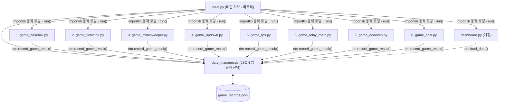

# 🧠 Mini-Game Hub 전체 코드 및 모듈별 알고리즘 분석서

> **분석 기준:** 프로젝트 루트의 전체 Python 모듈(`.py`) 및 공용 데이터(`game_records.json`) 분석  
> **개발 패러다임:** 순수 절차 지향 함수 모듈화 (`class` 미사용, 단일 진입점 `def run():`, `st.session_state` 접두사 분리)

---

## 1. 전체 시스템 아키텍처 및 진행 현황

### 1.1 모듈 호출 구조

### 1.2 전체 모듈 구현 현황 (10 / 11 완료 · 약 91%)

| 구분 | 파일명 | 게임 키 (`game_key`) | 세션 접두사 | 기록 기준 (`lower_is_better`) | 상태 |
| --- | --- | --- | --- | --- | --- |
| 코어 | `main.py` | - | `game_data`, `current_menu` | - | ✅ 완료 |
| 코어 | `data_manager.py` | - | `game_data` | - | ✅ 완료 |
| 1번 | `game_baseball.py` | `baseball` | `bb_` | `True` (최소 시도 횟수) | ✅ 완료 |
| 2번 | `game_tictactoe.py` | `tictactoe` | `ttt_` | `True` (최소 착수 횟수) | ✅ 완료 |
| 3번 | `game_minesweeper.py` | `minesweeper` | `ms_` | 미사용 (`score=None`, 승패만 기록) | ✅ 완료 |
| 4번 | `game_updown.py` | `updown` | `ud_` | `True` (최소 시도 횟수) | ✅ 완료 |
| 5번 | `game_rps.py` | `rps` | `rps_` | `False` (최고 연승) | ✅ 완료 |
| 6번 | `game_relay_math.py` | `relay_math` | `dice_` | `False` (최고 연속 정답) | ✅ 완료 |
| 7번 | `game_oddeven.py` | `oddeven` | `oddeven_` | `False` (최고 연승) | ✅ 완료 |
| 8번 | `game_coin.py` | `coin` | `coin_` | `False` (최고 연승) | ✅ 완료 |
| 통계 | `dashboard.py` | - | - | - | 🚧 미구현 (0 B) |

---

## 2. 공통 코어 모듈 알고리즘

### 2.1 `main.py` — 동적 모듈 로딩 및 상태 기반 라우팅
- **핵심 알고리즘:**
  1. **안전한 동적 바인딩 (`is_module_ready`, `load_module_runner`)**
     - `importlib.import_module(module_name)` + `importlib.reload(module)`로 모듈을 런타임에 불러오고 `hasattr(module, "run") and callable(...)`로 진입점 존재 여부를 검증.
     - 파일이 비어 있거나 문법 오류가 발생해도 예외를 잡아 `render_placeholder()`로 안전하게 폴백(Fallback).
  2. **세션 상태 기반 SPA 화면 전환 (`current_menu`, `navigate_to`)**
     - `st.session_state.current_menu`에 현재 화면 이름을 저장하고, 로비의 4×2 카드 버튼이나 상단 `⬅️ 메인 로비로 돌아가기` 버튼 클릭 시 상태를 갱신 후 `st.rerun()`으로 즉시 화면 전환.
  3. **최근 플레이 기록 피드 (`render_recent_logs`)**
     - `game_records.json`의 `logs` 배열에서 슬라이싱 `logs[-5:][::-1]`으로 최신 5건을 $O(k)$ ($k=5$)에 추출해 표로 출력.

### 2.2 `data_manager.py` — 공용 JSON 영구 저장 및 최고 기록 갱신
- **핵심 알고리즘 (`record_game_result`):**
  1. `os.path.exists()`로 `game_records.json` 존재 여부를 확인하고 없으면 `GAME_KEYS` 기반 기본 스키마(`get_default_data`)를 자동 생성.
  2. 게임 종료 시 `summary[game_key]["played"] += 1`, 승리 시 `wins += 1`.
  3. **양방향 최고 기록 갱신 로직:**
     - `current_best is None`이면 첫 승리 점수를 즉시 등록.
     - `lower_is_better=True`이면 `score < current_best`일 때 갱신 (시도 횟수·시간 등).
     - `lower_is_better=False`이면 `score > current_best`일 때 갱신 (연승·콤보 등).
  4. `logs` 리스트에 `{timestamp, player, game, result, score}` 객체를 추가하고 UTF-8(`ensure_ascii=False, indent=4`)로 파일과 `st.session_state.game_data`를 동시 동기화.

---

## 3. 미니게임 8종 모듈별 알고리즘 상세

### 3.1 `game_baseball.py` — ⚾ 1. 숫자 야구 게임
- **핵심 자료구조:** `bb_secret` (길이 3 정수 리스트), `bb_history` (시도별 딕셔너리 리스트)
- **알고리즘 흐름:**
  1. **비복원 무작위 정답 생성:** `random.sample(range(1, 10), 3)`으로 1~9 중 중복 없는 3자리 숫자 생성.
  2. **3단계 입력 유효성 검증 (`validate_input`):**
     - 숫자 여부 및 길이 3 검사 (`isdigit()` & `len == 3`)
     - `'0'` 포함 여부 검사
     - 집합 변환(`len(set(user_input)) == 3`)으로 중복 숫자 검출 — 시간 복잡도 $O(L)$ ($L=3$).
  3. **스트라이크/볼 판정 (`judge_strike_ball`):**
     - `enumerate(guess)`로 각 자릿수 순회:
       - `num == secret[i]` → `strikes += 1`
       - `num in secret` → `balls += 1`
     - `strikes == 0 and balls == 0`이면 `OUT`, `strikes == 3`이면 승리(`lower_is_better=True`), 9회 소진 시 패배.

---

### 3.2 `game_tictactoe.py` — ⭕ 2. 틱택토
- **핵심 자료구조:** `ttt_board` (길이 9의 1차원 리스트, 2차원 좌표 `(row, col)` → `idx = row * 3 + col` 매핑)
- **알고리즘 흐름:**
  1. **승패·무승부 판정 (`check_winner`):**
     - 가로 3줄, 세로 3줄, 대각선 2줄의 8가지 인덱스 튜플(`win_lines`)을 순회하며 `board[a] == board[b] == board[c] != ""` 검사 ($O(1)$).
     - 승자가 없고 `"" not in board`이면 `"DRAW"` 반환.
  2. **3단계 휴리스틱 AI (`get_ai_move`):**
     - **1단계 (공격):** 모든 빈 칸에 `"X"`를 임시 배치(`board.copy()`)해 `check_winner == "X"`인 즉시 승리 수를 우선 선택.
     - **2단계 (수비):** 모든 빈 칸에 `"O"`를 임시 배치해 `check_winner == "O"`인 플레이어의 승리 위협 칸을 차단.
     - **3단계 (탐색):** 해당 사항이 없으면 남은 빈 칸 중 `random.choice(empty_cells)` 선택.
  3. **2단계 상태 전이 딜레이 연출 (`ttt_ai_thinking`):**
     - 플레이어 착수 시 먼저 화면에 `🔵`를 렌더링한 뒤(`st.rerun()`), 다음 렌더링 사이클에서 `time.sleep(0.6)` 후 `handle_ai_move()`를 실행해 자연스러운 턴제 대전 구현.

---

### 3.3 `game_minesweeper.py` — 💣 3. 지뢰찾기
- **핵심 자료구조:** `ms_board` (2차원 정수 격자, `MINE = -1`, `0~8`은 인접 지뢰 수), `ms_revealed` / `ms_flagged` (2차원 불리언 격자), `ms_fog_cells` (안개 좌표 `set`)
- **알고리즘 흐름:**
  1. **고난도 후보 보드 최적화 (`generate_challenging_board`, `measure_board_easiness`):**
     - 첫 클릭 시점까지 지뢰 배치를 지연(Lazy Generation)하여 첫 수 폭사 방지.
     - 난이도별 안전 구역(`build_safe_zone`: `cross` / `tight` / `single`)을 제외한 위치에 지뢰를 무작위 배치한 후보 보드를 `CANDIDATE_TRIALS = 12`개 생성.
     - 각 후보에 대해 `(첫 클릭 BFS 개방 칸 수, 전체 0-칸 개수)` 튜플을 계산해 값이 가장 작은(공짜 개방이 적고 추리 밀도가 높은) 보드를 채택.
  2. **8방향 인접 지뢰 카운팅:** 각 비지뢰 칸마다 `DIRECTIONS` 8방향을 탐색해 인접 `MINE` 개수를 사전 계산 — $O(R \cdot C)$.
  3. **BFS 연쇄 개방 (`reveal_cell`):** `collections.deque` 큐를 사용해 값이 `0`인 칸을 열면 인접 8방향의 미개방·무깃발 안전 칸을 너비 우선 탐색으로 자동 개방 — $O(R \cdot C)$.
  4. **코드 열기 (`is_chord_ready`, `chord_reveal`):** 열린 숫자 칸 주변의 깃발 수가 해당 숫자와 정확히 일치하면, 그 숫자를 재클릭해 주변 미깃발 칸을 일괄 개방 (오답 깃발 시 즉시 폭발).
  5. **안개 타일 이격 배치 (`select_fog_cells`):** 고급 난이도에서 숫자 힌트 중 최대 9개를 `❓`로 숨기되, `abs(r - fr) > 1 or abs(c - fc) > 1` 조건으로 안개끼리 인접하지 않도록 배치해 논리적 추리 가능성 유지.
  6. **경계선 우선 돌파 힌트 (`use_hint`):** 판당 1회, `hard_frontier`(안개 또는 숫자 3+ 인접 미개방 안전 칸) → `normal_frontier`(열린 칸 인접 안전 칸) → `all_safe` 순으로 우선 탐색해 개방.

---

### 3.4 `game_updown.py` — 🔢 4. 업 앤 다운
- **핵심 자료구조:** `ud_min_num`, `ud_max_num`, 실시간 축소 구간 `[ud_low, ud_high]`, `ud_history`
- **알고리즘 흐름:**
  1. **이진 탐색 기반 유동 기회 산출 (`calculate_max_attempts`):**
     - 사용자가 슬라이더(`0 ~ 1000`)로 설정한 구간 크기 `span = max_num - min_num + 1`에 대해 `max(4, span.bit_length())` ($\approx \lfloor \log_2(\text{span}) \rfloor + 1$)을 최대 기회로 자동 계산하여 어떤 범위에서도 이진 탐색으로 클리어 가능하도록 보장.
  2. **최소 구간 보정 (`clamp_range`):** 슬라이더 폭이 `MIN_RANGE_SPAN = 10` 미만이면 상한선/하한선을 자동 보정.
  3. **탐색 구간 실시간 축소 (`handle_guess`):**
     - `guess < secret` (`UP`) → `ud_low = max(ud_low, guess + 1)`
     - `guess > secret` (`DOWN`) → `ud_high = min(ud_high, guess - 1)`
     - 이미 배제된 구간 밖의 숫자를 입력하면 `validate_input()`에서 기회 차감 없이 재입력 유도.
  4. **비례 거리 온도 힌트 (`get_proximity_tag`):** 전체 범위 대비 오차 비율(`2%` / `8%` / `25%`)에 따라 `🔥 초근접` / `♨️ 꽤 가까움` / `🌬️ 보통 거리` / `🧊 아주 멈` 4단계 피드백 제공.

---

### 3.5 `game_rps.py` — ✊ 5. 가위바위보
- **핵심 자료구조:** `RPS_WIN_RULE = {"가위": "보", "바위": "가위", "보": "바위"}`, `rps_streak`, `rps_history`
- **알고리즘 흐름:**
  1. **해시맵 상수 시간 승패 판정 (`judge_round`):**
     - 동일 선택 → `"무승부"`, `RPS_WIN_RULE[player] == computer` → `"승리"`, 그 외 `"패배"` — $O(1)$.
  2. **콜백 기반 즉시 상태 갱신 (`on_click=play_round`):**
     - 버튼 클릭 시 화면 재렌더링 전에 `play_round()`가 먼저 실행되어 상단 누적 지표가 1프레임 지연 없이 즉시 반영됨.
     - 무승부는 전적 파일에 저장하지 않고 연승을 유지하며, 승리 시 연승 +1(`lower_is_better=False`), 패배 시 연승 0으로 초기화.
  3. **NumPy 벡터화 통계 (`calc_rps_statistics`):**
     - 불리언 마스크 합계(`np.sum(results == "승리")`)로 승/패/무 및 선택 비율 계산.
     - 무승부를 제외한 판의 누적 승률을 `np.cumsum(win_flags) / np.arange(1, N + 1) * 100`으로 계산해 `st.line_chart()`로 시각화.

---

### 3.6 `game_relay_math.py` — ➕ 6. 주사위 합 연속 맞추기
- **핵심 자료구조:** `dice_values` (주사위 눈 리스트), `dice_start_time` (출제 타임스탬프), `dice_streak`, `dice_history`
- **알고리즘 흐름:**
  1. **다면체 주사위 시뮬레이션 (`roll_new_dice`):** 사용자 설정(2~4개, D6/D8/D12/D20)에 따라 `[random.randint(1, dice_sides) for _ in range(dice_count)]` 생성.
  2. **정밀 타임어택 판정 (`render_active_gameplay`):**
     - 문제 출제 시 `dice_start_time = time.time()` 기록, 제출 시 `경과_시간 = time.time() - dice_start_time` 계산.
     - **우선순위 판정:** ① `경과_시간 > 제한_시간` (시간 초과 → 즉시 종료) → ② 미입력 경고 → ③ `int(입력값) == sum(현재_주사위)` (연승 +1 및 즉시 다음 문제 출제 + 타이머 리셋) → ④ 오답(즉시 종료).
  3. **동적 폼 키 자동 초기화:** `st.form(key=f"dice_answer_form_{현재_연속}")`처럼 라운드 번호를 위젯 키에 포함해 다음 문제 진입 시 입력창을 자동 초기화.
  4. **종료 시 일괄 전적 기록 & NumPy 분석 (`finish_challenge_and_record`, `render_challenge_data`):**
     - 1연속 이상이면 `is_win=True`, 0연속이면 `is_win=False`로 `relay_math`에 기록(`lower_is_better=False`).
     - `np.mean()`, `np.min()`으로 평균·최단 풀이 시간 산출 및 Pandas 표 출력.

---

### 3.7 `game_oddeven.py` — 🎲 7. 홀짝 맞추기
- **핵심 자료구조:** `oddeven_mode` (운/머리 듀얼 모드), `oddeven_active` (연속 출제 상태), `oddeven_dice_list`, `oddeven_history`
- **알고리즘 흐름:**
  1. **모듈로 연산 홀짝 판정 (`judge_parity_and_save`):**
     - `주사위_합계 = sum(dice_list)`, `실제_홀짝 = "홀수" if 주사위_합계 % 2 != 0 else "짝수"` — $O(D)$ ($D$: 주사위 개수).
  2. **듀얼 모드 상태 머신:**
     - **🎲 운으로 맞추기 (`render_luck_mode`):** 예측 우선 방식 — 버튼 클릭 시 6면체 주사위 2개를 굴려 즉시 판정(시간 제한 없음).
     - **🧠 머리로 맞추기 (`render_brain_mode`):** `oddeven_active` 플래그 기반 연속 출제 — 3~4개 다면체(6/8/10/12면체) 주사위를 보여주고 제한 시간(5~10초) 내 암산 판정. 정답이면 즉시 새 주사위 출제 및 타이머 리셋, 오답/시간초과 시 `oddeven_active = False`로 종료.
  3. **세션 미니 대시보드 (`render_bottom_dashboard`):**
     - 내부 보조 키(`_승리여부`, `_실제홀짝`, `_소요시간_수치`)를 분리 보관하여 표 타입 충돌을 방지하고, NumPy `np.mean()`으로 세션 승률·평균 반응 속도·홀짝 출현 비율 계산 후 Pandas 내림차순 표 출력.

---

### 3.8 `game_coin.py` — 🪙 8. 동전 던지기
- **핵심 자료구조:** `coin_streak`, `coin_history`, `coin_last_result`
- **알고리즘 흐름:**
  1. **균등 베르누이 시행 (`toss_coin_and_record`):**
     - `random.choice(["앞면", "뒷면"])`으로 50:50 독립 시행 수행.
     - 예측 일치 시 `coin_streak += 1`, 불일치 시 `coin_streak = 0` 후 즉시 `dm.record_game_result("coin", is_win=성공_여부, score=현재_연승, lower_is_better=False)` 저장.
  2. **세션 통계 분석 (`render_bottom_dashboard`):**
     - NumPy 배열 변환으로 세션 승률(`np.mean`), 앞면/뒷면 출현 비율, 세션 최대 연승(`np.max`)을 계산하고 Pandas `sort_values(by="회차", ascending=False)`로 최신순 기록표 출력.

---

## 4. 미구현 모듈 (`dashboard.py`) 구현 방향
- 현재 프로젝트에서 **유일하게 비어 있는 모듈(0 B)**입니다.
- **권장 구현 구성:**
  1. `dm.load_data()`로 `game_records.json` 로드 후 `summary`와 `logs`를 각각 Pandas DataFrame으로 변환.
  2. 상단 KPI (`st.metric`): 총 플레이 횟수, 총 승리 수, 전체 종합 승률, 최다 플레이 게임.
  3. 종목별 분석 차트: 8종 게임별 승률 막대 차트(`st.bar_chart`), 게임별 플레이 비중표 및 최고 기록 현황표.
  4. 전체 상세 로그 필터(게임별·승패별 필터링) 및 최근 기록 테이블 출력.

---

## 5. 전체 코드 점검 결과 (개선 권장 포인트)

1. **`best_score` 초기값 `None` 표시 버그 가능성 (`game_relay_math.py`, `game_oddeven.py`, `game_coin.py`):**
   - `game_records.json` 초기 스키마에서 `best_score`는 `null`(`None`)입니다.
   - `게임_요약.get('best_score', 0)`은 키가 존재하고 값이 `None`일 때 `0`이 아니라 `None`을 반환하므로, 첫 승리 전 화면에 **`None연속` / `None연승`**으로 표시될 수 있습니다.
   - **권장 수정:** `게임_요약.get('best_score') or 0`
2. **`main.py` 6번 게임 설명 문구 불일치:**
   - 6번 게임 제목은 `"➕ 주사위 합 연속 맞추기"`로 변경되었으나, `games_info`의 설명은 여전히 `"두 자리 수 덧셈/뺄셈 5문제 스피드 퀴즈"`로 남아 있습니다. 실제 구현(`game_relay_math.py`)에 맞춰 `"제한 시간 안에 주사위 눈 합계 연속 맞히기"` 등으로 통일하면 완성도가 높아집니다.
3. **구문 및 임포트 안정성:**
   - 구현된 10개 `.py` 파일 모두 `py_compile` 문법 검사 통과 완료 (오류 0건).
